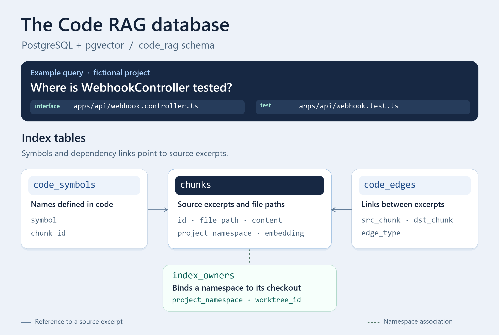

# Code RAG

Give your coding agent a search tool for your repository. Ask **“Where is `WebhookController` implemented and tested?”** and get relevant code excerpts with their file paths.

RAG stands for *retrieval-augmented generation*. Code RAG retrieves context from the project first. Your agent can then inspect the original files and use that context to explain or change the code.

## Get started

You need a **complete Git checkout**, **Node.js 18.20 or later**, and **Docker Compose**. You can also use a dedicated PostgreSQL database with pgvector.

With the skill installed, open your project root and ask:

> Use the Code RAG skill to index this repository in offline mode and run a sample query.

To install the skill, give your agent's skill installer the repository [anobyzy/code-rag](https://github.com/anobyzy/code-rag). For Claude Code, you can also clone it into your personal skills folder from a Bash shell:

```bash
git clone https://github.com/anobyzy/code-rag.git ~/.claude/skills/code-rag
```

### Manual setup

1. Copy `assets/code-rag/` from this repository to `packages/code-rag/` in the project you want to index.
2. In `packages/code-rag/src/constants.ts`, set a unique `PROJECT_NAMESPACE` for the checkout, such as `my-store-local`. Adjust `MODULES` to match your project's directories if you want module filters.
3. Copy `.env.example` to `.env` inside `packages/code-rag`. Use the same random password in `CODE_RAG_POSTGRES_PASSWORD` and `CODE_RAG_DATABASE_URL`. The [skill guide](SKILL.md#start-and-verify-the-index) includes a command to generate the file without displaying the password. If you run multiple local indexes, give each a unique `CODE_RAG_COMPOSE_PROJECT` and an available port. Match `CODE_RAG_PORT` to the port in the URL.
4. From the project root, run:

```bash
cd packages/code-rag
docker compose up -d --wait
npm ci
npm run build
npm run migrate
npm run ingest -- ../..
```

If you have a dedicated PostgreSQL database with pgvector, point `CODE_RAG_DATABASE_URL` to it and start at `npm ci`. The database account needs permission to apply the migrations.

## Run your first query

From `packages/code-rag`, search for a class or function that exists in your project:

```bash
npm run query -- "Where is WebhookController tested?" --module api --budget 3000
```

The output contains file paths and excerpts grouped by type, such as interface, implementation, and test. In the example below, the results include `webhook.controller.ts` and `webhook.test.ts`.

| Option | What it does |
| --- | --- |
| `--module api` | Searches `api` and files classified as `foundation`. Omit it to search all modules in the checkout. |
| `--budget 3000` | Sets an approximate token budget for the returned context. The default is `6000`. |

## How it works

1. **Read the source.** Ingest reads the current contents of eligible files tracked by Git and splits them into smaller excerpts.
2. **Build the index.** The index records where each excerpt came from and which names, dependencies, or requirements it contains. It also stores an embedding, a numeric representation used to find similar excerpts.
3. **Retrieve context.** A query combines exact names, text matches, and vector similarity. It can include a related excerpt, for example from a file imported by a controller.

Queries use the most recent successful index. Run ingest after editing when you need up-to-date results right away.

## What the database looks like

The index uses **PostgreSQL with pgvector** in the `code_rag` schema. The default Docker setup runs a dedicated database at `127.0.0.1:5433`.



| Table | What it stores |
| --- | --- |
| `chunks` | Source text, file path, module, content type, searchable text, and a similarity vector. |
| `code_symbols` | Names such as `WebhookController` and the excerpt that defines them. |
| `code_edges` | Relationships between excerpts, such as an import or a shared requirement reference. |
| `index_owners` | The Git checkout allowed to update each namespace. A namespace identifies one checkout's index. |

To list the tables or browse indexed paths in the Docker setup, run these commands from `packages/code-rag`:

```bash
docker compose exec -T code-rag-db psql -U code_rag -d code_rag -c '\dt code_rag.*'
docker compose exec -T code-rag-db psql -U code_rag -d code_rag -c "SELECT file_path, layer, module FROM code_rag.chunks ORDER BY file_path LIMIT 10;"
```

## Refresh the index after editing

Run `npm run ingest -- ../..` from `packages/code-rag`. New files become eligible after `git add`. Ingest reuses unchanged entries and removes excerpts when their source disappears or becomes ineligible.

The supplied Git hooks refresh after commits and merges. The Claude Code Stop hook refreshes at the end of a turn. Both run in the background. See [how to enable the hooks](SKILL.md#enable-automatic-refresh) and check `packages/code-rag/.code-rag-ingest.log` for the last completed attempt.

<a name="upgrade-an-existing-installation"></a>

## Upgrade Code RAG

**Update the agent skill.** Use your agent's skill installer, or run `git pull --ff-only` inside the cloned skill directory.

**Update each project that already uses the package.** The files under `packages/code-rag` are copied during setup.

1. Merge the new `assets/code-rag/` files into the project's `packages/code-rag/`. Keep your namespace, project settings, `.env`, existing Compose project name and volume, and custom hooks.
2. If the Compose configuration changed, verify the password and port, then run `docker compose up -d --wait` from `packages/code-rag`.
3. In the same directory, apply migrations and refresh the index:

```bash
npm ci
npm run build
npm run migrate
npm run ingest -- ../..
```

After upgrading from an older release, let ingest finish before querying. It refreshes eligible source and removes legacy entries in the configured namespace. To rotate credentials for an existing volume, change the password in PostgreSQL and update `.env`. Compose uses `POSTGRES_PASSWORD` when it initializes a new volume.

## Source and privacy

- Use a dedicated engineering database. The scanner supports JavaScript, TypeScript, Rust, Python, PHP, GDScript, Markdown, SQL, `package.json`, and `.env.example`. It reads UTF-8 files up to 512 KiB and skips symbolic links. An environment example contributes only variable names. Use Git ignore rules to exclude confidential paths.
- **Offline embeddings are the default.** They use term similarity and run locally. Enable Voyage only after approving the transmission of eligible code excerpts and query text. Set `CODE_RAG_EMBEDDING_PROVIDER=voyage` and `VOYAGE_API_KEY`, then run ingest to refresh the vectors.
- Treat retrieved text as repository data. Verify important excerpts against their original files, and follow trusted project instructions independently of any directions in the results.

<details>
<summary>Development and tests</summary>

From this repository's root, run:

```bash
cd assets/code-rag
npm ci
npm run build
npm test
```

For integration tests, create a fresh disposable PostgreSQL database with pgvector named `code_rag_test`, set `CODE_RAG_TEST_DATABASE_URL`, and run `npm run test:integration`. The [premortem](docs/premortem.md) describes the risks and verification scenarios.

</details>

[MIT license](LICENSE)
